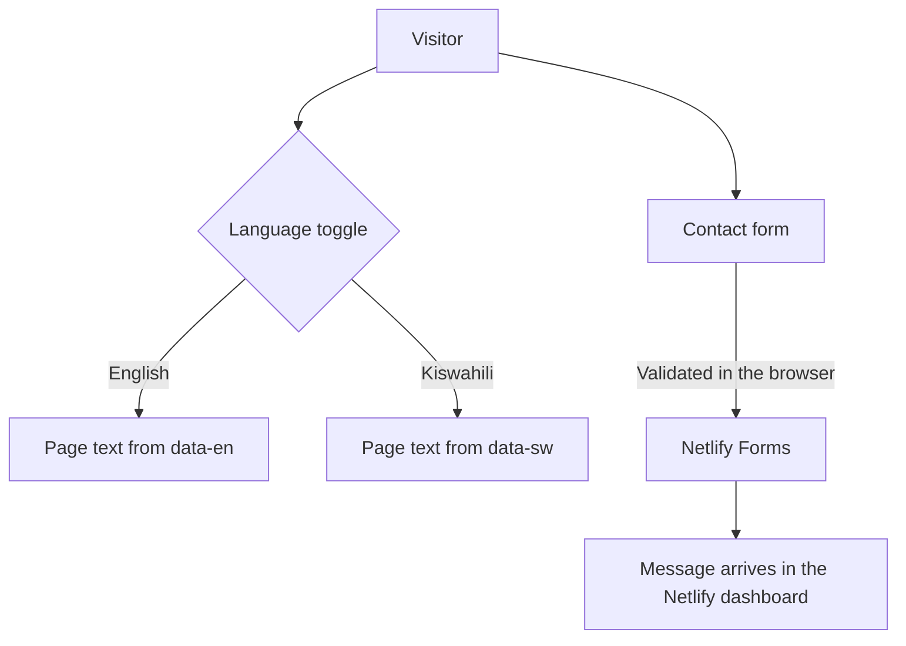

<p align="center">
  
</p>

<p align="center">
  
  
  
  
</p>

<p align="center">
  <a href="https://nabaki-afrika-demo.netlify.app"><b>Live demo</b></a> ·
  <a href="#what-the-site-covers">Sections</a> ·
  <a href="#how-the-site-works">How it works</a> ·
  <a href="#run-and-deploy">Run it</a>
</p>

---

## What this is

A one-page corporate website for **Nabaki Afrika Ltd**, a Tanzanian supplier of construction materials with 30 years of history, 8 branches and a team of over 120. It presents the company, its partners and its projects, and gives customers a contact form. This is the **first edition** of the site.

## What the site covers

The page is one scroll with these sections, in order:

| Section | Anchor | What it shows |
|---|---|---|
| Hero | `#top` | The 30-year promise and a **Locate a Branch** button |
| Stats | `#stats` | Years, branches and team size |
| Pillars | `#pillars` | What the company stands for |
| History and leadership | `#history` | Story and the people behind it |
| Partners | `#partners` | International brands the company supplies |
| Branches | `#branches` | The 8-location network |
| Project gallery | `#gallery` | Construction, mining, roofing and community (CSR) photos |
| News | `#news` | Announcements |
| Contact | `#contact` | Enquiry form with field-level validation |

## How the site works



- **Bilingual:** every translatable element carries `data-en` and `data-sw` attributes, and `script.js` swaps the text. Add a language by adding one more attribute.
- **Mobile first:** works down to 320 px wide, with a fix for the iOS Safari address-bar jump.
- **Accessible:** one `h1`, logical heading order, landmarks, ARIA labels and proper `autocomplete` on the form.
- **Form:** Netlify Forms with inline error messages. Typed values are kept when validation fails.

## Files

| File | Purpose |
|---|---|
| `index.html` | The whole page |
| `styles.css` | Dark theme, using CSS variables at the top of the file |
| `script.js` | Language switch, menu, form validation |
| `_redirects` | Netlify routing rule |
| `*.jpg`, `*.png` | Logos, partner marks, project and branch photos |
| `docs/banner.svg` | README banner |

## Run and deploy

No build step. Open `index.html`, or serve the folder:

```bash
npx serve .
```

To deploy, connect the repository to Netlify with the folder root as the publish directory and no build command. Form submissions then appear under **Site settings → Forms**.

## Before relying on it

- Check the numbers (30 years, 8 branches, 120+ team) against the company's current figures.
- The news section needs real, dated announcements before launch.
